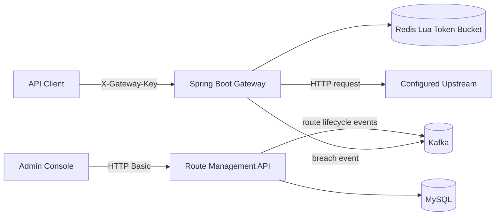

# Gatekeeper — API Gateway & API Management

A Java 21 / Spring Boot API gateway learning project with route administration, dynamic upstream forwarding, Redis token-bucket rate limiting, MySQL route persistence, and Kafka events.

> **Status:** Portfolio / learning project. It is not production-hardened. Upstream target allow-listing and SSRF protection, TLS, secret management, resilience policies, and deployment hardening remain necessary before production use.

## Architecture



## Technology

Java 21 · Spring Boot 3.4 · Spring Security · Spring Data JPA · MySQL · Redis Lua · Apache Kafka · Maven · Docker · React · Vite.

## Implemented features

- Admin CRUD endpoints at /api/admin/routes.
- HTTP Basic authentication for route administration.
- Dynamic upstream forwarding at /gateway/{routeKey}/**.
- Shared gateway-key validation through X-Gateway-Key.
- Atomic Redis Lua token bucket with configurable capacity and continuous 60-second refill.
- Kafka route lifecycle events and rate-limit breach events on gateway.rate-limit-events.
- Upstream response status and end-to-end response headers are passed through, excluding hop-by-hop headers.
- Actuator health endpoint.
- Dockerfile and Docker Compose app + MySQL + Redis + Kafka.
- Testcontainers integration tests for real Redis rate limiting and MySQL persistence.

## Run the complete stack

Prerequisites: Docker Desktop with Compose.

1. Set non-demo credentials in a private .env file before exposing the service.
2. Build and start all services:

```bash
docker compose up --build
```

3. Check application health:

```bash
curl http://localhost:8080/actuator/health
```

The API is available at http://localhost:8080. Kafka is available to host tools at localhost:29092 and to Compose services at kafka:9092.

### Environment variables

| Variable | Default (local demo only) | Purpose |
|---|---|---|
| APP_ADMIN_USER | admin | Admin username |
| APP_ADMIN_PASSWORD | change-me-now | Admin password |
| GATEWAY_SHARED_KEY | local-demo-key | Gateway caller key |
| DB_URL | Compose supplies MySQL URL | JDBC URL |
| DB_USER / DB_PASSWORD | root / root | MySQL credentials |
| REDIS_HOST / REDIS_PORT | redis / 6379 in Compose | Redis connection |
| KAFKA_BOOTSTRAP_SERVERS | kafka:9092 in Compose | Kafka broker |

Do not use demo credentials outside local development. Use a private .env file and never commit secrets.

## API examples

Create an upstream route:

```bash
curl -u admin:change-me-now -X POST http://localhost:8080/api/admin/routes \
  -H "Content-Type: application/json" \
  -d '{"routeKey":"users","targetUrl":"http://host.docker.internal:9001","active":true,"requestsPerMinute":60}'
```

Forward a request:

```bash
curl http://localhost:8080/gateway/users/api/users \
  -H "X-Gateway-Key: local-demo-key"
```

## Run tests

Prerequisites: JDK 21, Maven 3.9+, and Docker available to Testcontainers.

```bash
mvn -B verify
```

The Testcontainers suite starts disposable MySQL and Redis containers and verifies persistence and token-bucket enforcement. GitHub Actions runs Maven verification and the frontend production build on pushes and pull requests.

## Known limitations / next steps

- Restrict upstream URLs to an explicit trusted-host allow-list; the current admin route URL can otherwise create SSRF risk.
- Add outbound connection/read timeouts, payload limits, TLS, structured audit logs, and circuit breakers.
- Rate-limit breach events are emitted to Kafka; a separate consumer/alerting workflow is not included yet.
- The token bucket capacity is the configured requests-per-minute value and refills continuously over 60 seconds. It is not a fixed-window counter.
- Configure production-grade credentials, secret storage, and database migrations before deployment.

## License

MIT
