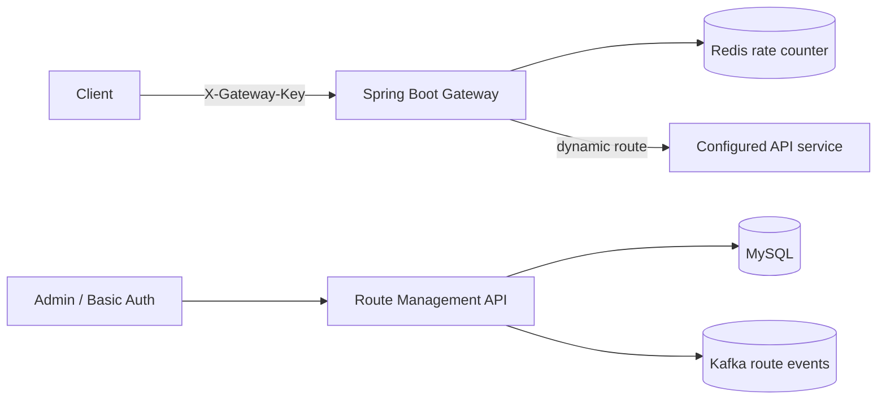

# Gatekeeper — API Gateway & API Management

A Spring Boot learning project implementing a configurable HTTP gateway with an API management control plane, Basic-authenticated administration, Redis-backed request limiting, MySQL route persistence, and Kafka route-change events.

> **Status:** Initial runnable backend implementation committed. This is a learning/MVP implementation, not a production-hardened gateway. The React route-management console is included. MongoDB analytics, distributed gateway instances, JWT-based admin login, and automated integration tests remain future work. Review and test locally before using this project as evidence of production experience.

## Architecture



## Stack
Java 21 · Spring Boot 3.4 · Spring Security · Spring Data JPA · MySQL · Redis · Apache Kafka · Maven · Docker Compose.

## Implemented
- Admin CRUD for gateway routes at `/api/admin/routes`.
- Spring Security HTTP Basic authentication for administration (configure credentials through environment variables).
- Dynamic forwarding at `/gateway/{routeKey}/**` to the configured upstream URL.
- Shared gateway-key check using `X-Gateway-Key`.
- Per-route, per-client fixed-window request limiting using Redis.
- Kafka event publication when routes are created, updated, or deleted.
- Actuator health endpoint.

## Run locally
Prerequisites: JDK 21, Maven 3.9+, Docker Desktop.

```bash
docker compose up -d
mvn spring-boot:run
```

Admin defaults are for local development only: username `admin`, password `change-me-now`. Override `APP_ADMIN_USER` and `APP_ADMIN_PASSWORD` before exposing the app. Set `GATEWAY_SHARED_KEY` to a long random secret.

## API examples

Create a route (admin Basic Auth):
```bash
curl -u admin:change-me-now -X POST http://localhost:8080/api/admin/routes \
  -H "Content-Type: application/json" \
  -d '{"routeKey":"users","targetUrl":"http://localhost:9001","active":true,"requestsPerMinute":60}'
```

List routes:
```bash
curl -u admin:change-me-now http://localhost:8080/api/admin/routes
```

Forward a request:
```bash
curl http://localhost:8080/gateway/users/api/users \
  -H "X-Gateway-Key: local-demo-key"
```

## Configuration
| Variable | Default | Purpose |
|---|---|---|
| APP_ADMIN_USER | admin | Admin username |
| APP_ADMIN_PASSWORD | change-me-now | Local-only admin password |
| GATEWAY_SHARED_KEY | local-demo-key | Gateway caller key |
| DB_URL | jdbc:mysql://localhost:3306/gatekeeper?createDatabaseIfNotExist=true | MySQL JDBC URL |
| DB_USER / DB_PASSWORD | root / root | MySQL credentials |
| REDIS_HOST / REDIS_PORT | localhost / 6379 | Redis |
| KAFKA_BOOTSTRAP_SERVERS | localhost:9092 | Kafka broker |

## Security and limitations
- Replace all demo credentials and shared keys before deployment.
- Restrict upstream target URLs to trusted hosts and add SSRF protections before production use.
- Add request/response size limits, timeouts, retries, circuit breakers, structured audit logging and TLS.
- The current rate limiter is a Redis fixed-window counter; it is not a token-bucket implementation.
- Kafka events are emitted by the control plane; a distributed gateway consumer/cache refresh is not yet implemented.
- The React admin console is available in `frontend/`; it currently uses HTTP Basic authentication and is intended for local development.

## Source and learning reference
This implementation is independently written from the project topics described in the Coder Army GateKeeper series. It is not a copy of the instructor's members-only source code. Course: https://www.youtube.com/playlist?list=PLEYgx5hMdopw

## License
MIT
