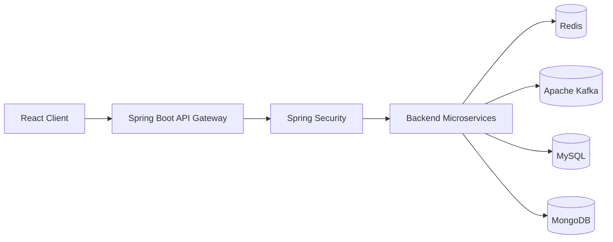

# Gatekeeper — Architecture Overview

> Conceptual diagram based on the project scope. Verify actual service boundaries, request paths, and data ownership against the source code before treating this as an implementation diagram.

## Components
- **React client:** User-facing application.
- **API Gateway:** Central entry point and request-routing layer.
- **Spring Security:** Authentication and role-based authorization.
- **Redis:** Caching and rate-limiting support.
- **Apache Kafka:** Asynchronous messaging and event processing.
- **MySQL / MongoDB:** Relational and document persistence.

## Verification checklist
1. Replace the generic backend group with actual service names.
2. Confirm where authentication and authorization are enforced.
3. Confirm which service owns each database/table/collection.
4. Document real Kafka topics, event schemas, and routes only after verifying them.